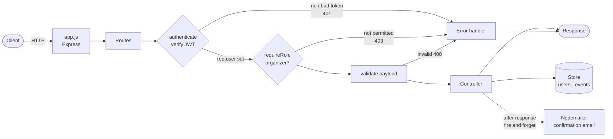

# Virtual Event Management Platform - Backend

   

A REST API for running virtual events: user registration and authentication, event scheduling with role-based permissions, and attendee registration with email confirmation.

Built with Node.js and Express. Written to be read - layered structure, one responsibility per module, and explicit error handling at the boundaries.

---

## Request flow



Authentication, authorization and validation are three separate gates. Each one fails into the same central error handler, so the API returns one error shape regardless of where it broke.

---

## What it does

- **Authentication** - registration and login with bcrypt password hashing and JWT-based sessions
- **Authorization** - organizers and attendees are distinct roles; event mutation is organizer-only, enforced in middleware
- **Event management** - full CRUD over events (date, time, description, participant list)
- **Attendee registration** - users register for events; duplicate registration is rejected
- **Email notifications** - confirmation sent asynchronously on successful registration, using async/await and Promises
- **Tests** - covering the auth flow and the events API

## API

| Method | Endpoint | Auth | Description |
|---|---|---|---|
| `POST` | `/register` | - | Create an account |
| `POST` | `/login` | - | Authenticate, returns JWT |
| `GET` | `/events` | Yes | List events |
| `POST` | `/events` | Organizer | Create an event |
| `PUT` | `/events/:id` | Organizer | Update an event |
| `DELETE` | `/events/:id` | Organizer | Delete an event |
| `POST` | `/events/:id/register` | Yes | Register as an attendee |

## Project structure

```
app.js          Express app, middleware chain, route mounting
Routes/         Route definitions, thin - no business logic
Controller/     Request handling, validation, responses
Middleware/     Authentication, role authorization, error handling
Modal/          Data models and the in-memory store
```

The data layer sits behind functions rather than exposing raw structures directly, so the storage backend can be swapped for MongoDB or Postgres without touching route or controller code.

## Engineering decisions

**Why bcrypt, not a fast hash.** bcrypt is deliberately slow and salted. Fast hashes like SHA-256 are built for throughput, which is exactly the wrong property for passwords - it makes brute-forcing cheap.

**Why JWT.** Stateless, so the API scales horizontally without shared session storage. The trade-off is that a token cannot be revoked before it expires; short expiry is the mitigation, and a denylist would be the next step.

**Authentication and authorization are separate middlewares.** `authenticate` establishes who you are; `requireRole` decides what you may do. Conflating them makes permissions impossible to reason about as roles grow. 401 for unauthenticated, 403 for authenticated-but-forbidden.

**Email is fired after the response, not awaited in the request path.** Registration has already succeeded by then - a down mail server should not fail the user's request.

**In-memory storage is a deliberate constraint.** It means state does not survive a restart and diverges across instances behind a load balancer. The store is isolated behind an interface so moving to a real database is a contained change.

## Running it

```bash
npm install
cp .env.example .env    # fill in your values
npm start
npm run test
```

## Built with

Node.js - Express.js - bcrypt - jsonwebtoken - Nodemailer - Jest

---

Built as part of a structured backend engineering program.
